<div align="center">

# PromptRoute-Mamba

### Reliability-Aware Infrared-Visible Image Fusion with Prompt-Guided Routing and State-Space Modeling

[](https://www.python.org/)
[](https://pytorch.org/)
[](https://github.com/state-spaces/mamba)
[](#)

</div>

## Overview

PromptRoute-Mamba decomposes each modality into base and detail representations, performs reliability-aware prompt routing in the base stream, and uses state-space modeling for efficient long-range cross-modal coordination. Training follows a stable two-stage strategy: representation learning first, fusion learning second.

<p align="center">
  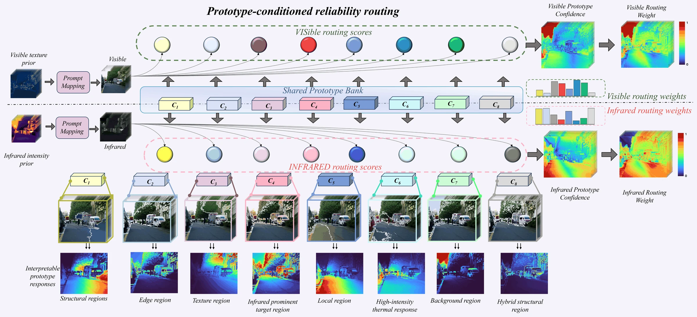
  <br><sub><b>Prompt-guided prototype routing.</b></sub>
</p>

### Highlights

- **Prompt-guided reliability routing** for position-wise modality selection.
- **Mamba-based global modeling** with a complementary high-frequency detail path.
- **Two-stage optimization** that preserves a stable, decodable representation space.

## Setup

The recommended environment is Python 3.8, PyTorch 2.4.1, CUDA 12.4, and `mamba-ssm` 2.2.2.

```bash
conda env create -f environment.yaml
conda activate prompt-route-mamba
```

Expected dataset layout:

```text
MSRS/
├── train/
│   ├── ir/
│   └── vi/
└── test/
    ├── ir/
    └── vi/
```

## Datasets

| Dataset | Official website / download |
|:--|:--|
| **MSRS** | [Dataset page](https://github.com/Linfeng-Tang/MSRS) |
| **RoadScene** | [Dataset page](https://github.com/hanna-xu/RoadScene) |
| **TNO** | [Dataset page](https://figshare.com/articles/dataset/TNO_Image_Fusion_Dataset/1008029) |
| **LLVIP** | [Dataset page](https://github.com/bupt-ai-cz/LLVIP) |
| **M3FD** | [Dataset page](https://github.com/JinyuanLiu-CV/TarDAL#m3fd-dataset) |

Please follow the license and citation requirements provided by each dataset owner. Dataset files are not redistributed in this repository.

## Training

### 1. Prepare aligned HDF5 patches

Place MSRS under `datasets/MSRS`, or set `PROMPTROUTE_DATASET_ROOT` to its location, then run:

```bash
python dataprocessing.py
```

### 2. Run two-stage training

Training reads the generated HDF5 file from `data/`. Use `PROMPTROUTE_TRAIN_H5` for a custom path.

```bash
python train.py
```

During epochs 1-30, the shared encoder and decoder learn base-detail decomposition and reconstruction. During epochs 31-100, their parameters are frozen while the base and detail fusion modules are optimized. Checkpoints are saved under `models/`; TensorBoard events are written to `runs/`.

## Testing

Place paired test images under `test/ir` and `test/vi` with identical filenames. Set the checkpoint, dataset name and paired-image folder (Linux example):

```bash
PROMPTROUTE_CHECKPOINT=models/PromptRoute-Mamba_seed0_XX-XX-XX-XX.pth \
PROMPTROUTE_DATASET=MSRS \
PROMPTROUTE_TEST_DIR=/path/to/MSRS/test \
python test_IVF.py
```

Use `MSRS`, `RoadScene`, `TNO` or `LLVIP` for the dataset name. The script saves fused PNG images under `test_result/<dataset>` and reports image-wise means and standard deviations for EN, SD, SF, MI, SCD, VIF, Qabf, and SSIM. It uses the same inference path for all four datasets and performs no per-image min-max stretching.

## Key Experimental Results

<p align="center">
  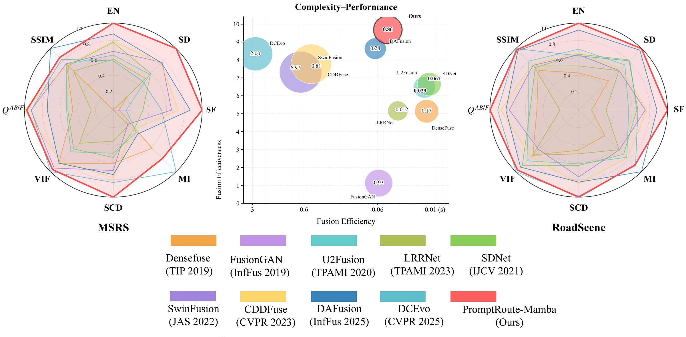
  <br><sub><b>Performance-complexity comparison on MSRS and RoadScene.</b></sub>
</p>

<p align="center">
  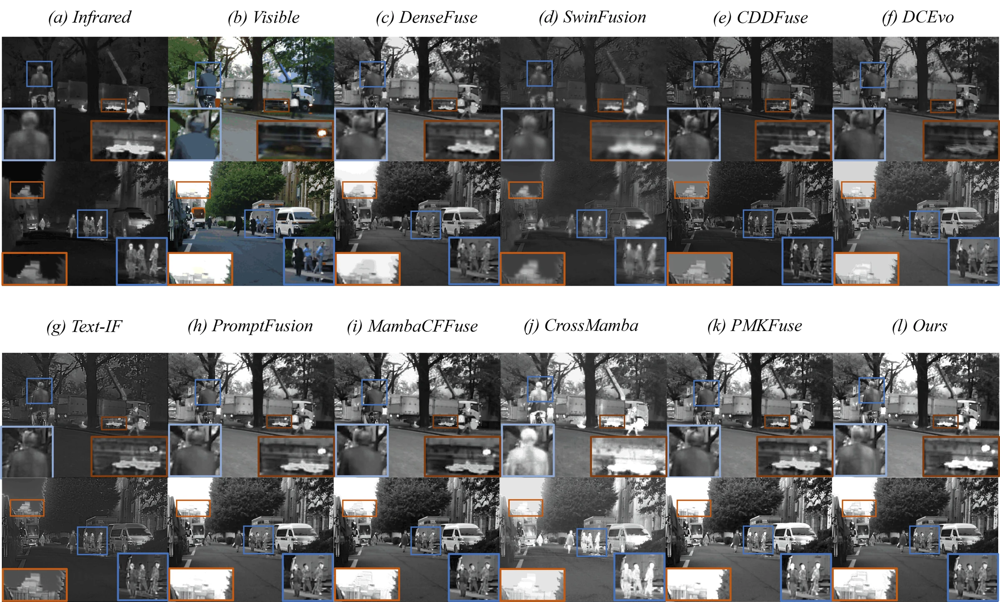
  <br><sub><b>Qualitative comparison on representative MSRS image pairs.</b></sub>
</p>

<p align="center">
  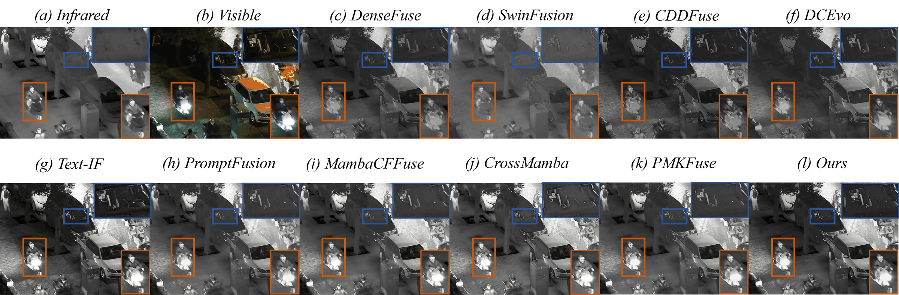
  <br><sub><b>Zero-shot qualitative comparison on the low-light LLVIP dataset.</b></sub>
</p>

<p align="center">
  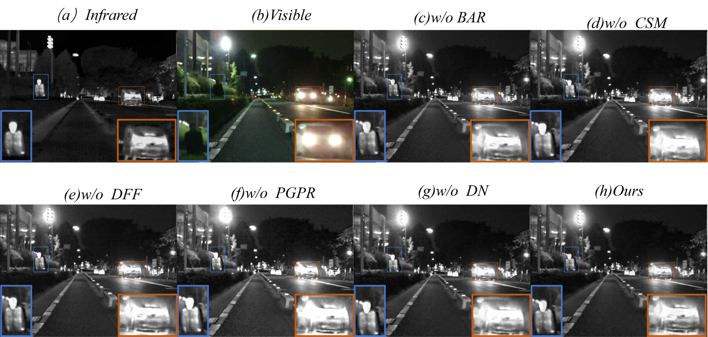
  <br><sub><b>Qualitative ablation analysis of the principal model components.</b></sub>
</p>

<p align="center">
  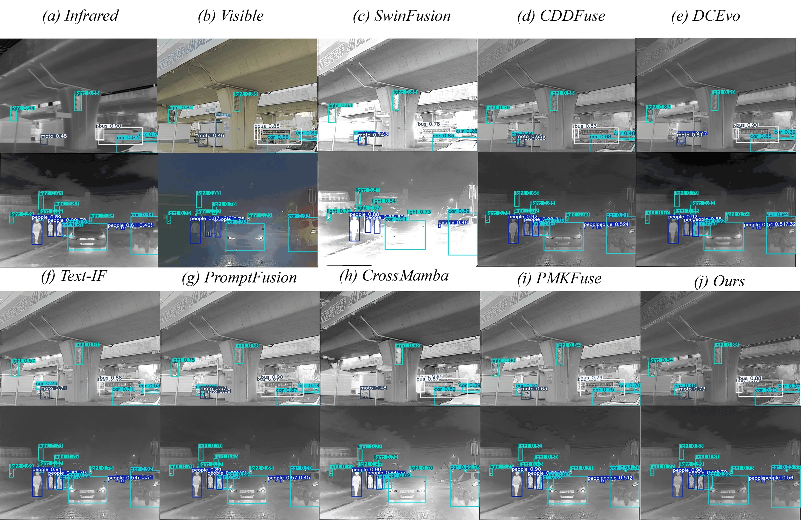
  <br><sub><b>Downstream object detection comparison on M3FD.</b></sub>
</p>

<p align="center">
  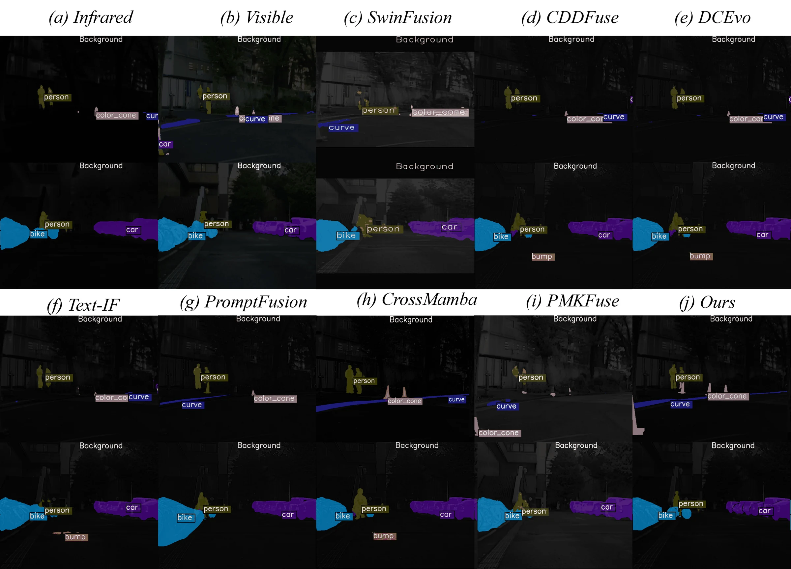
  <br><sub><b>Downstream semantic segmentation comparison on MSRS.</b></sub>
</p>

## Figure Gallery

The remaining paper figures are shown below in a full-width, single-column layout without repeating the figures above.

<p align="center">
  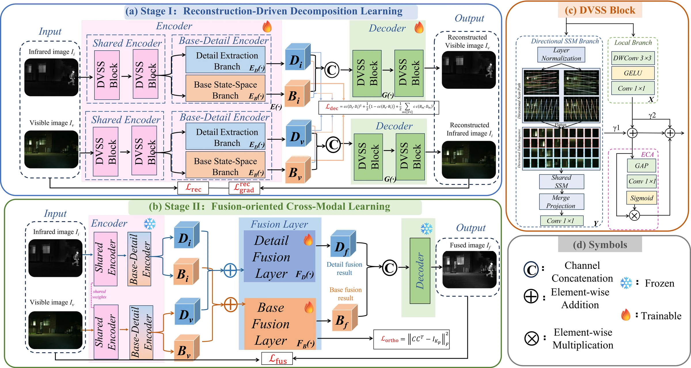
  <br><sub><b>Overall architecture of PromptRoute-Mamba.</b></sub>
</p>

<p align="center">
  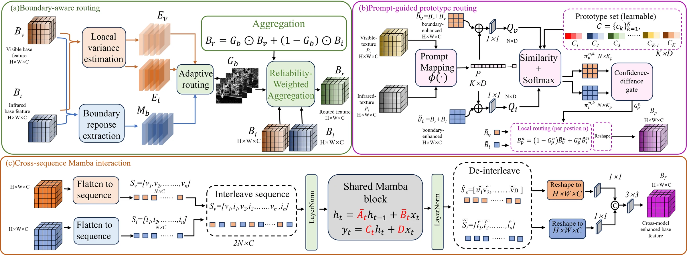
  <br><sub><b>Reliability-aware base fusion layer.</b></sub>
</p>

<p align="center">
  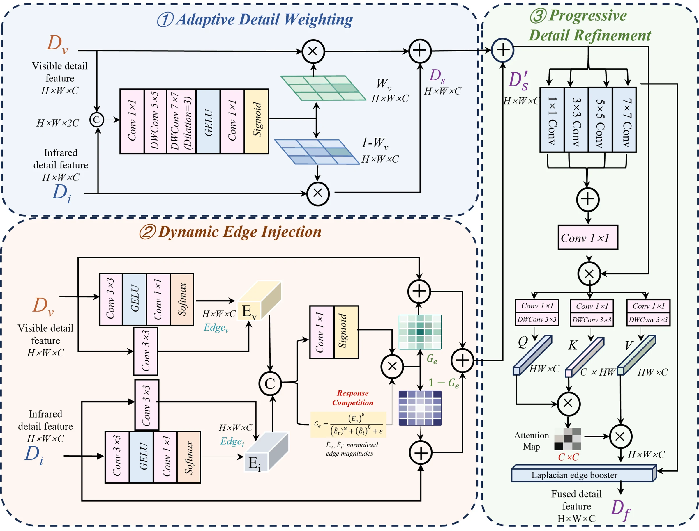
  <br><sub><b>Detail fusion layer.</b></sub>
</p>

<p align="center">
  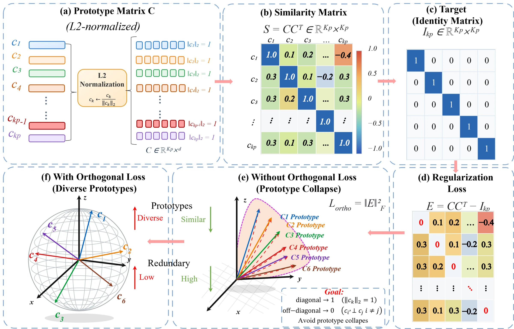
  <br><sub><b>Orthogonal prototype regularization.</b></sub>
</p>

<p align="center">
  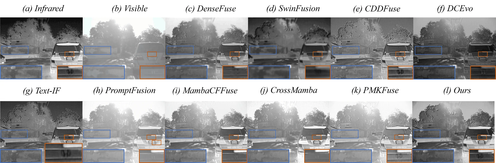
  <br><sub><b>RoadScene qualitative comparison.</b></sub>
</p>

<p align="center">
  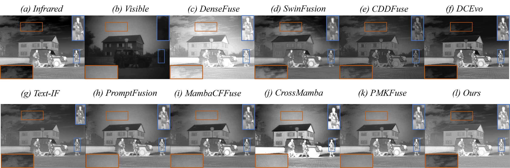
  <br><sub><b>TNO qualitative comparison.</b></sub>
</p>

<p align="center">
  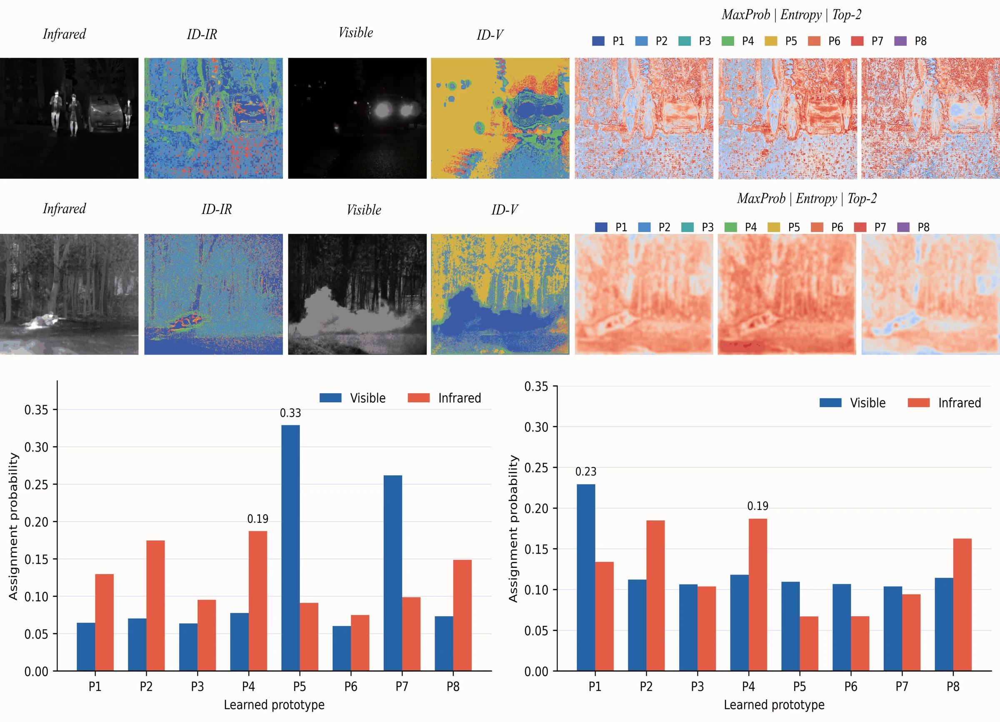
  <br><sub><b>Prototype-response analysis.</b></sub>
</p>

<p align="center">
  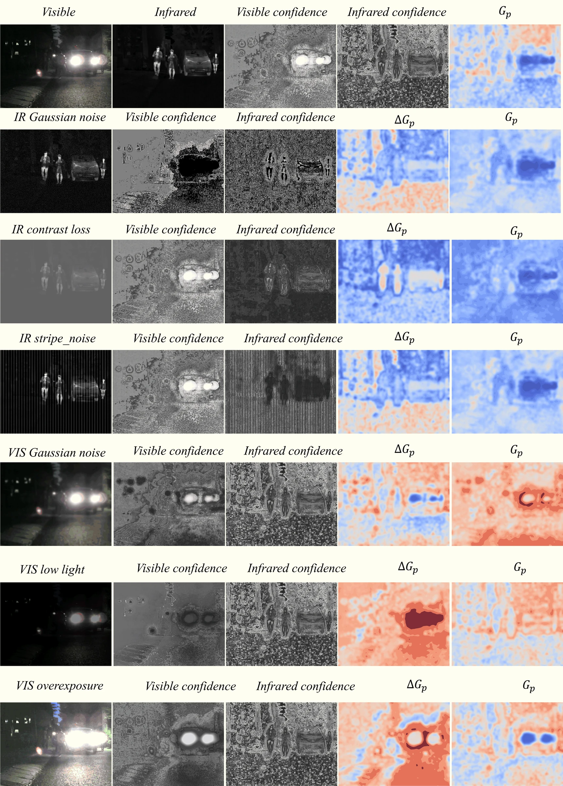
  <br><sub><b>Reliability under controlled corruptions.</b></sub>
</p>

<p align="center">
  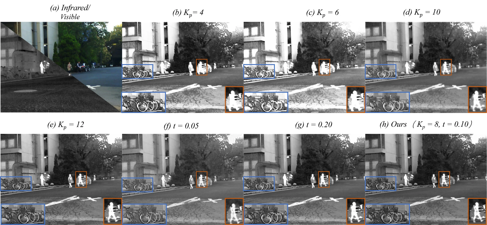
  <br><sub><b>Parameter sensitivity analysis.</b></sub>
</p>

<p align="center">
  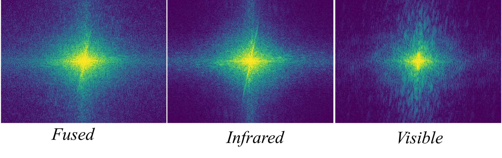
  <br><sub><b>Power spectral density analysis.</b></sub>
</p>

## Repository Layout

```text
PromptRoute-Mamba/
├── assets/figures/      # complete paper figure gallery
├── utils/               # data, losses, metrics, and image I/O
├── dataprocessing.py    # paired patch preparation
├── net.py               # PromptRoute-Mamba architecture
├── train.py             # two-stage optimization
├── test_IVF.py          # inference and evaluation
└── environment.yaml
```

Datasets, checkpoints, logs, TensorBoard runs, caches, and generated results are intentionally excluded from version control.

## Citation

```bibtex
@article{wang2026promptroutemamba,
  title   = {PromptRoute-Mamba: Reliability-Aware Infrared--Visible Image Fusion with Prompt-Guided Routing and State-Space Modeling},
  author  = {Wang, Dongming and Mou, Xingang and Wu, Sihan and Zhou, Xiao},
  year    = {2026}
}
```

## Acknowledgement

This implementation builds on ideas and utilities from [CDDFuse](https://github.com/Zhaozixiang1228/MMIF-CDDFuse) and the [Mamba](https://github.com/state-spaces/mamba) ecosystem.
